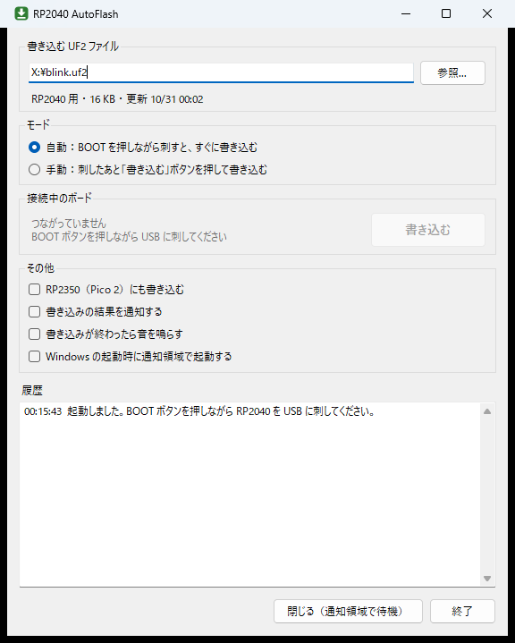

# RP2040 AutoFlash

BOOT ボタンを押しながら USB に刺した RP2040 に、決めておいた UF2 ファイルを書き込む Windows の常駐アプリです。刺すだけで書き込む「自動モード」と、ボタンを押したときだけ書き込む「手動モード」を切り替えて使えます。



## できること

- **自動モード** — BOOT を押しながら刺すと、約 0.8 秒後に書き込みます。
- **手動モード** — 刺すと画面が前に出るので、「書き込む」ボタン（または通知領域メニューの「今すぐ書き込む」）で書き込みます。
- **UF2 ファイルの指定** — パスの入力・「参照...」・ドラッグ＆ドロップで指定します。中身（どのチップ用か、大きさ、更新日時）を表示し、チップが合わない UF2 は書きません。
- **書くたびに読み直す** — ビルドし直した UF2 がそのまま使われます。
- **結果の確認** — 書き込み後にボードが再起動（ドライブが消える）すれば完了、しなければ警告します。通知と音で知らせます（設定で止められます）。
- **書き込みの繰り返し防止** — 書いた直後 4 秒以内に同じボードが書き込みモードへ戻ってきたら（UF2 が起動しなかったとき）、自動では書き直しません。起動時にすでに刺さっていたボードにも自動では書きません。
- **RP2350（Pico 2）** — 設定で有効にすると対象に入ります。
- **常駐** — 通知領域に入ります。Windows の起動時に起動する設定もあります。

## 使い方

1. [Releases](https://github.com/Nch-MOSFET/RP2040AutoFlash/releases/latest) から `RP2040AutoFlash.exe` をダウンロードし、書き込みできるフォルダ（デスクトップやドキュメントなど）に置いて起動します（インストール不要）。署名していないので、初回は「Windows によって PC が保護されました」と出ることがあります。「詳細情報」→「実行」で起動できます。
2. 書き込む UF2 ファイルを指定し、モードを選びます。設定は変えた時点で、exe と同じフォルダの `RP2040AutoFlash.ini` に保存されます。
3. RP2040 の BOOT ボタンを押しながら USB に刺します。

× や「閉じる」では通知領域に隠れるだけです。やめるときは「終了」ボタンか、通知領域の右クリックメニューから。

### 注意

- Arduino IDE などのツールで書き込むときは、ツール自身がボードを書き込みモードにして UF2 をコピーします。自動モードのままだと本アプリも同時に書き込もうとしてぶつかるので、そのあいだは手動モードにしてください。
- ボードは、書き込み用ドライブの `INFO_UF2.TXT` にある `Board-ID`（RP2040 は `RPI-RP2`、RP2350 は `RP2350`）で見分けます。

## ビルド

Windows 10/11 に入っている .NET Framework 4.x の C# コンパイラだけでビルドできます（Visual Studio や .NET SDK は要りません）。

```powershell
.\build.ps1          # bin\RP2040AutoFlash.exe を作る
.\build.ps1 -Test    # あわせてテストも実行する
```

### ボードなしで試す

環境変数 `RP2040AUTOFLASH_EXTRA_ROOTS` に書いたフォルダ（`;` 区切り）も、書き込み用ドライブとして扱います。そのフォルダに `Board-ID: RPI-RP2` の行を含む `INFO_UF2.TXT` を置くとボードを刺したときと同じ動きになり、`INFO_UF2.TXT` を消すとボードが再起動したことになります。

## ファイル構成

| パス | 内容 |
|---|---|
| `src/` | 本体（C# / WinForms） |
| `tools/MakeIcon.cs` | ビルド時にアイコンを作る |
| `tests/Tests.cs` | UF2 の読み取り・ボードの見分け・書き込みのテスト |
| `build.ps1` | ビルドスクリプト |

## ライセンス

[MIT](LICENSE)
